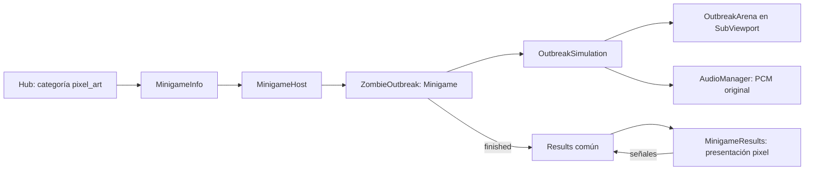

# Sección Pixel art

La colección **Pixel art · Acción** amplía Spooky World con una estética propia: el mismo Halloween nocturno, ahora convertido en un arcade de cementerio, luces de vela y zombis. Se entra desde el hub. La colección ilustrada conserva sus tres juegos y su estilo.

## Contrato visual

| Elemento | Regla |
| --- | --- |
| Resolución lógica | 320×180, presentación 1280×720 a escala 4 |
| Escalado | `SubViewportContainer.stretch_shrink = 4`, filtro nearest local |
| Personajes | 12×16; bruto 16×16; transparencia RGBA |
| Escenario | Módulos de 16 px; coberturas con posición de colisión explícita |
| Tipografía de partida | Bitmap original 5×7, espaciado de un píxel |
| HUD y resultados | Se renderizan dentro de la misma cuadrícula |
| Luz y partículas | Bloques de color y contrastes; sin suavizado ni desenfoque |
| Paleta | `Palette.PIXEL_*` más naranja, hueso, verde y rojo del proyecto |

El filtro del proyecto completo sigue siendo el de las ilustraciones. La sección pixel utiliza su propio viewport; así se evita pixelar el fondo pintado del menú. Godot documenta el escalado y la entrega de input de [SubViewports y sus contenedores](https://docs.godotengine.org/en/4.4/tutorials/rendering/viewports.html).

## Integración en la arquitectura



- `MinigameInfo.collection` selecciona la categoría; el valor por defecto es `illustrated`.
- `use_shared_hud = false` permite el HUD y la introducción propios. El host conecta puntos y fin, pero no muestra su cuenta regresiva común.
- `set_game_paused()` congela el reloj base. La raíz del juego congela además su simulación local.
- `exit_requested` permite abandonar por el host, sin acoplar el juego a navegación.
- `results_scene_path` es opcional. La escena debe extender `MinigameResults`, recibir puntaje/récord/fin y emitir decisiones; `Results` común las conecta con GameManager.
- No se añade ningún autoload.

## Arte entregado y reemplazo

Los PNG iniciales se generan desde patrones originales de `outbreak_art.gd`; el generador conserva archivos ya existentes. Son reemplazables por diseño en estas rutas:

| Archivo en `assets/art/zombie_outbreak/` | Tamaño lógico | Uso |
| --- | --- | --- |
| `player.png` | 12×16 | Guardia con chaqueta azul |
| `walker.png` | 12×16 | Zombi caminante, chaqueta violeta |
| `runner.png` | 12×16 | Corredor, chaqueta roja |
| `brute.png` | 16×16 | Bruto, hombros anchos y chaqueta naranja |
| `grave.png` | 12×16 | Lápida; colisión definida por `COVER` |
| `pumpkin.png` | 10×10 | Calabaza decorativa |
| `candle.png` | 6×8 | Vela decorativa |
| `medkit.png` | 8×8 | Botiquín |
| `card.png` | 320×160 | Vista previa en el hub |

Cada sprite se ancla en su centro. Sustituir PNG conservando tamaño y centro mantiene la geometría jugable. Un cambio de silueta que afecte colisiones requiere ajustar el radio o `COVER` y repetir pruebas. No mezclar sprites de 16 px y 64 px sin una decisión de estilo.

Para generar archivos ausentes durante desarrollo:

```powershell
godot --headless --path . -s res://tools/build_outbreak_art.gd
godot --headless --editor --path . --quit
```

## Referencias encontradas

- [Kenney Tiny Dungeon](https://kenney.nl/assets/tiny-dungeon): pack de 16×16, CC0, como alternativa futura de utilería pixel.
- [Animated Monsters, stealthix](https://opengameart.org/content/animated-monsters): monstruos con animaciones, incluido zombi; publicado como CC0. Si se adopta, alinear su escala y paleta y registrar los archivos concretos.

Ninguno de esos packs está incorporado a esta versión. Los sprites, la fuente bitmap y el audio incluidos son originales del prototipo; no se han copiado gráficos de los juegos de referencia.
