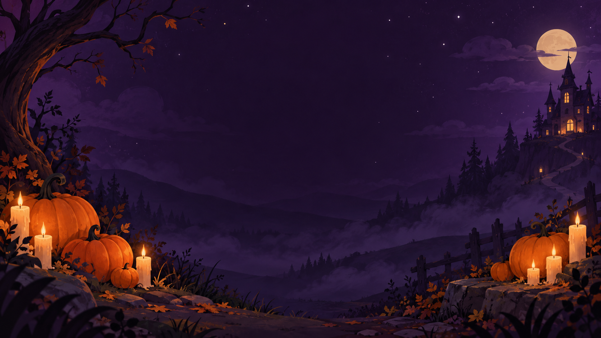

# Propuesta UX/UI — ilustración 2D

## Dirección visual

Halloween **amable y misterioso**: fondo nocturno violeta, luz naranja de calabazas y velas, siluetas legibles y detalles discretos. El arte final lo realiza la diseñadora; este documento define composición y comportamiento para que sus ilustraciones se integren sin improvisar la interfaz.

El [fondo temporal del menú](../assets/art/ui/ui_menu_background.png) ya está conectado a `scenes/main_menu/main_menu.tscn`. Es una guía de ambiente y composición, **no una referencia obligatoria de estilo final**.



## Jerarquía y recorrido

```text
MENÚ                    HUB                     PARTIDA                 RESULTADOS
Título + Jugar      →    3 tarjetas         →    Instrucción 3 s   →    Puntaje + récord
Acceso a sonido         Nombre / mecánica       HUD: puntos / tiempo     Otra vez (principal)
Salir (Windows)         Récord / controles      Pausa con Esc            Elegir otro (secundaria)
```

La acción principal debe destacar en cada pantalla. No esconder controles ni reglas esenciales en `tooltip`: muchas personas no pasan el cursor por todos los elementos. En Web, el primer clic en **Jugar** inicia la experiencia y da una oportunidad clara para habilitar el sonido.

## Boceto de composición, base 1280×720

### Menú

```text
┌──────────────────────────────────────────────────────────────────────────────┐
│ [Sonido]                                                                     │
│                                                                              │
│                       SPOOKY WORLD                                           │
│                    Minijuegos de Halloween                                   │
│                                                                              │
│                         [ JUGAR ]                                            │
│                      [ Cómo jugar ]                                          │
│                                                                              │
│                calabazas y velas en bordes, centro oscuro                    │
└──────────────────────────────────────────────────────────────────────────────┘
```

- El título y botones se mantienen dentro de una zona central de **760×450 px**.
- La ilustración no contiene texto ni botones. La UI queda como nodos `Control`, con foco y tamaño adaptables.
- CTA **Jugar**: mínimo 320×64 px. “Cómo jugar” abre un panel corto de controles; “Salir” solo en Windows.

### Hub

```text
┌──────────────────────────────────────────────────────────────────────────────┐
│ ← Menú       ELIGE UN MINIJUEGO                       Total de sesión: 000    │
│                                                                              │
│  ┌──────────────────┐  ┌──────────────────┐  ┌──────────────────┐            │
│  │ Ilustración      │  │ Ilustración      │  │ Ilustración      │            │
│  │ Pumpkin Catch    │  │ Ghost Whack      │  │ Haunted Maze     │            │
│  │ Mover · A/D      │  │ Golpear · clic   │  │ Escapar · WASD   │            │
│  │ Récord: 000      │  │ Récord: 000      │  │ Récord: 000      │            │
│  │ [ Jugar ]        │  │ [ Jugar ]        │  │ [ Jugar ]        │            │
│  └──────────────────┘  └──────────────────┘  └──────────────────┘            │
└──────────────────────────────────────────────────────────────────────────────┘
```

- Tres tarjetas de **360–380 px** de ancho, con margen exterior 48 px y separación 24 px.
- Si el ancho útil baja de 1100 px, pasar a dos columnas o una lista con desplazamiento. Evitar texto cortado.
- Cada tarjeta muestra nombre, mecánica, controles y récord de forma visible. La imagen es decorativa y tiene una versión comprensible sin ella.

### Partida y pausa

```text
┌──────────────────────────────────────────────────────────────────────────────┐
│ Nombre del juego          Puntos: 000                    00 s    [ Pausa ]    │
│                                                                              │
│                          ÁREA DE JUEGO                                       │
│                                                                              │
│               [3 · 2 · 1] + instrucción breve solo al inicio                 │
└──────────────────────────────────────────────────────────────────────────────┘

Pausa: [Reanudar]  [Reiniciar]  [Salir al hub]
       Confirmar salida si la partida ya comenzó.
```

- Reservar la franja superior del HUD para lectura; no colocar objetivos jugables detrás del texto.
- Temporizador con aviso visual a 10 s y 3 s. Un sonido puede acompañarlo, pero nunca ser la única señal.
- Esc abre/cierra la pausa; desde allí se sale al hub. En la pausa, detener reloj y generación de objetos.

### Resultados

- Mostrar nombre del juego, puntuación y récord con una frase específica: “Nuevo récord” o “Te faltaron X puntos”.
- Acción principal: **Otra vez**. Acción secundaria: **Elegir otro**. Mantener ambas navegables con Tab/flechas.
- Animación de entrada breve (≤ 250 ms); permitir reducir movimiento.

## Sistema visual para implementar en Godot

| Elemento | Propuesta |
| --- | --- |
| Fondo | `NIGHT` y `DUSK`; ilustración en bordes, centro calmado |
| Texto principal | `BONE`; tamaño base 24 px en 1280×720 |
| Título de pantalla | 48–72 px según pantalla; máximo dos líneas |
| CTA principal | `PUMPKIN`, 64 px de alto; texto oscuro, borde/foco visibles |
| Acción positiva | `SLIME` + icono de confirmación, nunca color solo |
| Error/peligro | `BLOOD` + icono/forma distinta y texto breve |
| Espaciado | Escala 8 px: 8, 16, 24, 32, 48 |
| Transiciones | 150–250 ms, sin animaciones que retrasen el inicio de una partida |
| Tipografía | **Patrick Hand** (OFL, `assets/fonts/`): única para toda la UI, trazo a mano como el arte |

La paleta existente ofrece, para texto sin transparencia, aproximadamente **15.3:1** (`BONE` sobre `NIGHT`) y **6.8:1** (`PUMPKIN` sobre `NIGHT`). Verificar cada estado final, porque las ilustraciones, opacidad y sombras cambian el contraste. Objetivo: ≥ 4.5:1 para texto normal y ≥ 3:1 para texto grande, según [WCAG 2.2](https://www.w3.org/WAI/WCAG22/Understanding/contrast-minimum).

Implementado en `assets/art/ui/spooky_theme.tres`, aplicado a todo el proyecto (`gui/theme/custom`). Variaciones: `TitleLabel` (logo), `HeaderLabel` (título de pantalla) y `PrimaryButton` (acción principal). El arcade pixel dibuja su propia UI y no lo usa. Diseño original: un recurso `Theme` compartido para botones, etiquetas y paneles; `MarginContainer`, `VBoxContainer` y `GridContainer` para tamaños variables; señales de los nodos existentes. [Godot recomienda contenedores](https://docs.godotengine.org/en/stable/tutorials/ui/gui_containers.html) y [anclajes](https://docs.godotengine.org/en/stable/tutorials/ui/size_and_anchors.html) para interfaces que se adapten al tamaño de ventana.

## Estados y accesibilidad

- Todos los botones: normal, hover, foco, pulsado y deshabilitado. El foco debe verse claramente sin ratón.
- Texto e icono para distinguir calabaza/bomba y fantasma objetivo/amigo. No comunicar reglas solo con naranja/rojo/blanco.
- Navegación con teclado en menú, hub, pausa y resultados; mostrar los controles del minijuego antes de jugar.
- Opción de silenciar Música y SFX. Probar una partida completa con audio apagado.
- Evitar parpadeo rápido, sacudidas largas y animaciones superpuestas al HUD.
- Probar a 1280×720, 1024×576 y ventana redimensionada; en Web PC no prometer soporte móvil todavía.

## Contrato para sustituir el fondo temporal

1. La diseñadora entrega **un PNG** llamado `ui_menu_background.png` en `assets/art/ui/`, 16:9, preferentemente 1920×1080 o 1280×720, sin texto incrustado y con el centro oscuro/despejado.
2. Reemplazar el archivo en esa misma ruta. La escena usa un `TextureRect` a pantalla completa con recorte proporcional; no hace falta tocar su script ni las señales de los botones.
3. Abrir Godot y esperar la reimportación. Revisar menú a 1280×720 y 1024×576; comprobar contraste de título y botones.
4. Mantener el archivo final razonablemente ligero para Web y registrar autoría/licencia en la entrega de arte.

Los sprites finales de calabaza, vela, fantasma, jugador, dulces y salida se entregan por separado con los nombres y tamaños de [ASSETS.md](ASSETS.md). El fondo temporal no se usa como atlas ni sustituye esos archivos.
