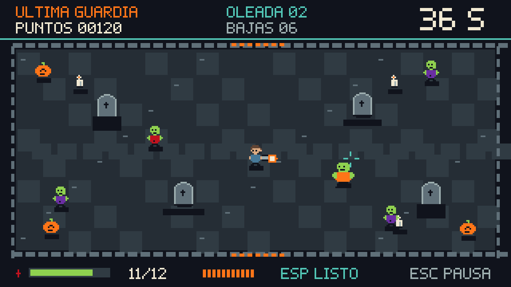
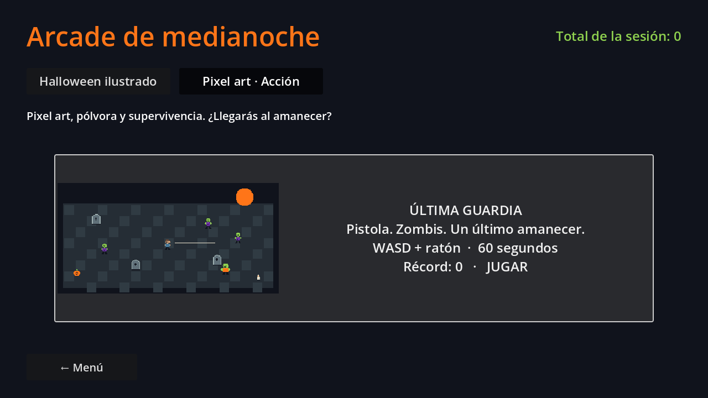
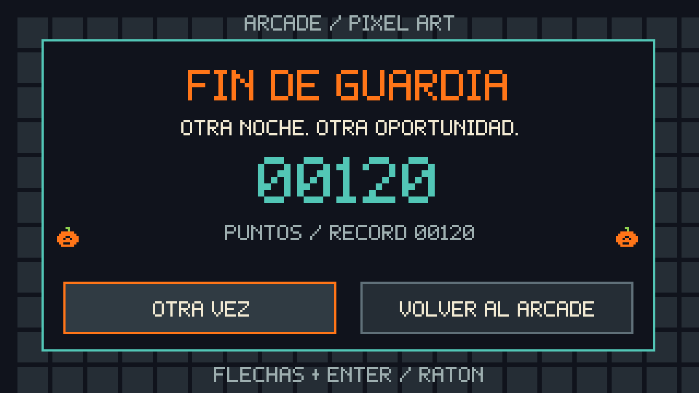

# Última guardia — diseño, plan y arquitectura

## Concepto y referencias

Shooter cenital de zombis para **Web en PC**, de una partida de 60 s: moverse entre lápidas, apuntar con ratón, controlar el cargador y sobrevivir al amanecer. El nombre de carpeta e identificador es `zombie_outbreak`; el nombre visible es **Última guardia**.

La búsqueda sirvió para elegir dos principios de diseño: supervivencia frente a oleadas de [20 Minutes Till Dawn](https://store.steampowered.com/app/1966900/20_Minutes_Till_Dawn/) y combate cenital con armas de [Nuclear Throne](https://store.steampowered.com/app/242680/Nuclear_Throne/). Son referencias de mecánica y ritmo; el escenario, personajes, reglas, sprites y sonidos del prototipo son propios.

## Versión jugable implementada

| Sistema | Comportamiento |
| --- | --- |
| Objetivo | Resistir 60 s; morir antes registra el puntaje conseguido |
| Movimiento | WASD o flechas; velocidad 66 píxeles lógicos/s |
| Pistola | Ratón para apuntar, mantener clic para disparar; cargador de 12 |
| Recarga | R o automática al intentar disparar vacío; 1.15 s |
| Cadencia | Un disparo cada 0.17 s |
| Esquiva | Espacio; 0.16 s de impulso con 1.8 s de cooldown |
| Vida | 100; contacto normal quita 20 y bruto 30; invulnerabilidad 0.85 s |
| Caminante | 1 impacto, velocidad 18, 10 puntos |
| Corredor | 1 impacto, velocidad 32, 15 puntos; aparece desde oleada 2 |
| Bruto | 4 impactos, velocidad 13, 40 puntos; aparece en oleada 3 |
| Oleadas | Cambian a los 20 y 40 s; intervalo de aparición baja progresivamente |
| Combo | Cinco bajas rápidas aumentan multiplicador, máximo ×3 |
| Curación | Cada 7 bajas cae un botiquín de +25, caduca a los 9 s |
| Cobertura | Cuatro lápidas bloquean movimiento y balas |
| Pausa | Esc congela reloj y simulación; volver al juego o abandonar al hub |
| Audio | Pistola, recarga, impacto, daño, esquiva, curación y bucle chiptune originales |

Los números son una primera curva de balance, no resultados de pruebas con jugadores. El objetivo de una sesión de prueba es que una persona nueva entienda mover/apuntar/disparar en 10 s y sobreviva al menos a la primera oleada tras dos intentos.

## Responsabilidades

| Componente | Responsabilidad |
| --- | --- |
| `zombie_outbreak.gd` | Adaptar input al espacio lógico, pausar, conectar señales a Minigame y audio |
| `outbreak_simulation.gd` | Estado de combate, ticks, cadencia, spawn, colisiones, límites y puntaje |
| `outbreak_tuning.gd` | Recurso del Inspector para velocidad, cadencia, recarga e intervalos de spawn |
| `OutbreakEnemy/Bullet/Particle/Pickup` | Entidades de datos tipadas y acotadas; no conocen escenas |
| `outbreak_arena.gd` | Dibujar escenario, sprites, efectos, fuente y HUD a 320×180 |
| `outbreak_art.gd` | Patrones originales, fuente y carga de PNG sustituibles |
| `outbreak_audio.gd` | Producir PCM sin APIs, descargas ni efectos de bus |
| `outbreak_results*` | Pantalla de resultados pixel; solo emite decisiones al contenedor común |

El modelo es `RefCounted` sin dependencias de `SceneTree`, input global ni navegación. Esto permite repetir semillas y probar una sesión completa sin renderizar. Las entidades no usan un nodo por bala: se mantienen colecciones pequeñas con máximos explícitos (44 enemigos, 48 proyectiles, 100 partículas), apropiadas para el alcance de esta arena Web. Una ampliación con rutas complejas puede justificar navegación y entidades de escena más adelante.

## Plan de producción

| Fase | Entregable | Estado / siguiente criterio |
| --- | --- | --- |
| A | Mecánica base, tres variantes, cobertura y recarga | Implementada; pruebas de simulación |
| B | Sección pixel en hub, HUD y resultados coherentes | Implementada; probar navegación y reintento |
| C | Arte original provisional y SFX con sustitución documentada | Implementada; contrato en `PIXEL_ART.md` |
| D | Playtest con 5 personas, balance y prueba Web real | Pendiente de personas y exportación en navegador |
| E | Animaciones direccionales, impactos más ricos y música definitiva | Siguiente iteración con diseño |
| F | Segunda arma o mapa alternativo | Solo tras validar claridad, rendimiento y balance del MVP |

Para la segunda arma se propone una escopeta de corto alcance: pocos cartuchos, dispersión y recarga lenta. No añadirla antes de medir si la pistola, esquiva y cobertura ya ofrecen decisiones suficientes. Una campaña, inventario persistente o multijugador requieren un alcance separado.

## Verificación reproducible

```powershell
godot --headless --path . -s res://tools/zombie_simulation_test.gd
godot --headless --path . res://tools/zombie_flow_test.tscn
godot --path . res://tools/zombie_flow_test.tscn -- --capture
```

La simulación comprueba consumo y cadencia, recarga, puntos al impactar, cobertura, daño e invulnerabilidad, botiquín, derrota, reinicio y límites durante 3600 ticks. El flujo comprueba descubrimiento en sección pixel, host, pausa y reanudación, resultados propios y reintento. La captura usa un renderer gráfico, no una imagen simulada.

La entrega Web todavía debe probarse en navegadores reales: audio después del clic inicial, escalado de puntería, pérdida de foco, teclado, derrota, supervivencia y retorno al hub. Las pruebas headless no sustituyen esas comprobaciones ni una prueba de rendimiento en el equipo objetivo.

## Capturas del renderer

La vista de combate usa un estado de prueba reproducible para mostrar los tres
tipos de enemigo, el HUD y los efectos. Las imágenes salen de Godot con OpenGL,
no de una maqueta dibujada aparte.





## Sustituir audio provisional

Los WAV opcionales `assets/audio/sfx/zombie_outbreak_<cue>.wav` tienen prioridad
sobre la síntesis original. Los valores de `<cue>` son `shot`, `reload`, `loaded`,
`hit`, `hurt`, `dash` y `heal`. La música final puede entregarse en
`assets/audio/music/zombie_outbreak_loop.ogg`, con bucle configurado al importar.
Mientras esos archivos no existan se conserva el audio generado del prototipo.
